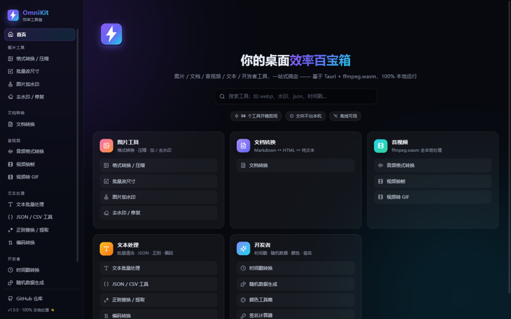
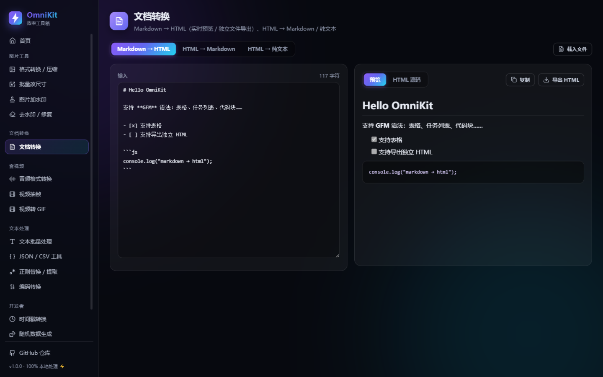
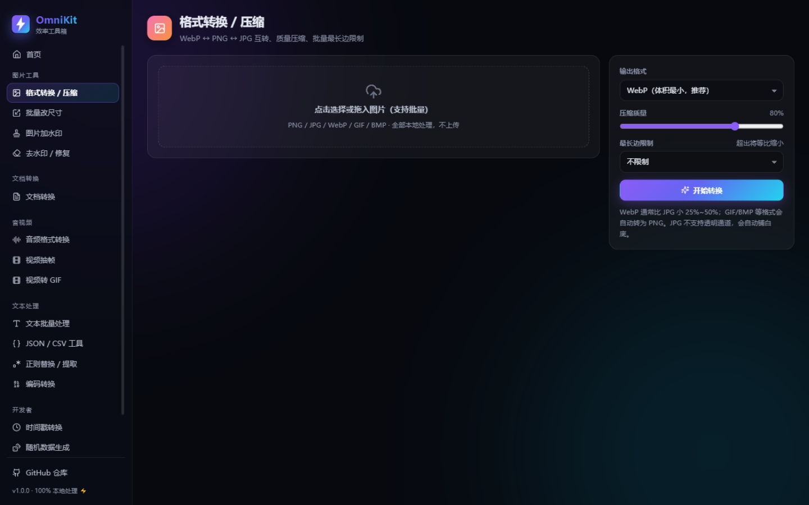
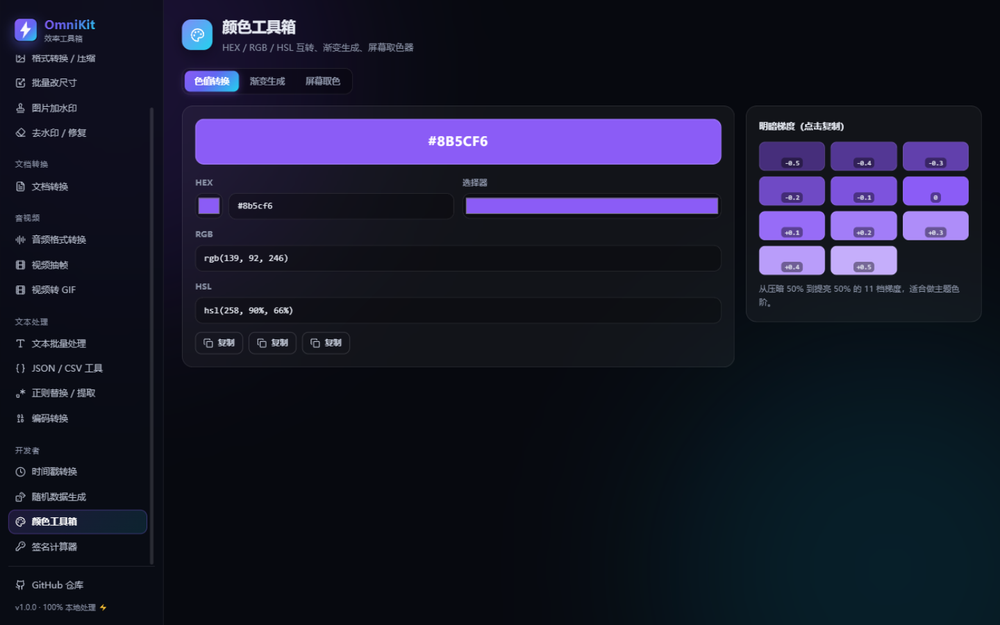

<div align="center">


# OmniKit · 效率工具箱

**一款开箱即用、100% 本地处理的跨平台桌面效率工具集**

图片 / 文档 / 音视频 / 文本 / 开发者工具，一个应用全搞定

[](https://github.com/OWNER/omnikit/actions/workflows/ci.yml)
[](https://github.com/OWNER/omnikit/actions/workflows/release.yml)
[](LICENSE)
[](https://tauri.app)
[](https://react.dev)

</div>

---

## ✨ 项目简介

OmniKit 是基于 **Tauri 2 + React 18 + TypeScript** 构建的桌面端效率工具箱，内置 **16 个高频工具**，覆盖日常办公与开发中的格式转换、批处理、编解码等场景。

**核心特色：所有文件处理均在本地完成（Canvas / WebAssembly / Web Crypto），零上传、零依赖服务器，断网也能用** —— 隐私安全与便携性兼得。

界面采用年轻人喜爱的**暗色玻璃拟态 + 渐变霓虹**设计语言，支持工具搜索、实时预览、批量处理。

| 首页 / 工具导航 | 文档转换 · 实时预览 |
|:---:|:---:|
|  |  |

| 图片格式转换 | 颜色工具箱 |
|:---:|:---:|
|  |  |

更多截图：[docs/screenshots](docs/screenshots/)

---

## 🧰 功能总览（16 个工具）

### 🖼 图片工具
| 工具 | 说明 |
|---|---|
| **格式转换 / 压缩** | WebP ↔ PNG ↔ JPG 互转，可调质量、最长边限制，批量处理 + 体积节省统计 |
| **批量改尺寸** | 按比例 / 指定宽高（锁定比例）/ 最长边三种缩放模式 |
| **图片加水印** | 文字 / 图片水印，9 宫格定位 + 全图平铺防盗图，透明度 / 旋转 / 间距可调，实时预览，批量导出 |
| **去水印 / 修复** | 画笔 / 矩形涂抹水印区域，**多尺度扩散（金字塔 + Gauss-Seidel）修复算法**自动填充背景，可多轮精修 |

### 📄 文档转换
| 工具 | 说明 |
|---|---|
| **Markdown ↔ HTML** | Markdown → HTML（GFM、实时分屏预览、导出自带样式的独立 HTML）、HTML → Markdown |
| **HTML → 纯文本** | 智能保留段落结构的文本提取 |

### 🎬 音视频（ffmpeg.wasm，内核内置离线可用）
| 工具 | 说明 |
|---|---|
| **音频格式转换** | MP3 / WAV / FLAC / OGG / M4A 互转，可调比特率，批量队列 |
| **视频抽帧** | 按帧率或时间间隔批量导出帧图（PNG/JPG），缩略图预览 + ZIP 打包 |
| **视频转 GIF** | 两遍调色板法（palettegen + paletteuse）生成高质量 GIF |

### 📝 文本处理
| 工具 | 说明 |
|---|---|
| **文本批量处理** | 去空行 / 去重复行 / 中文拼音排序 / 大小写转换，实时统计 |
| **JSON / CSV 工具** | JSON 格式化 / 压缩 / 校验，JSON ↔ CSV 双向互转（嵌套字段点分展开、类型推断） |
| **正则替换 / 提取** | 批量替换（分组引用）、提取手机号 / 邮箱 / URL / IP / 身份证等预设 |
| **编码转换** | URL / Base64 / Unicode / Hex 编码解码（UTF-8 安全，中文不乱码） |

### 🛠 开发者工具
| 工具 | 说明 |
|---|---|
| **时间戳转换** | 秒 / 毫秒自动识别 ↔ 日期，批量转换，实时时钟，相对时间 |
| **随机数据生成** | 大陆手机号、UUID v4、自定义 ID、**可视化字段编排的 Mock JSON 生成器** |
| **颜色工具箱** | HEX / RGB / HSL 互转、11 档明暗梯度、渐变生成器、EyeDropper 屏幕取色 |
| **签名计算器** | MD5 / SHA-1 / SHA-256 / SHA-512 / HMAC（后端接口签名常用），输入实时计算 |

---

## 🚀 快速开始

### 环境要求
- Node.js ≥ 18
- Rust toolchain（仅打包桌面端需要）
- Windows: WebView2（Win11 自带）/ macOS & Linux 各平台标准依赖

### 开发调试
```bash
git clone https://github.com/OWNER/omnikit.git
cd omnikit
npm install

# 浏览器内开发（无需 Rust）
npm run dev

# 桌面端开发（Tauri 窗口）
npm run tauri dev
```

### 构建安装包
```bash
npm run tauri build
# 产物：src-tauri/target/release/bundle/nsis/*.exe（Windows）
```

> 📦 **不想自己构建？** Release 页面提供 CI 自动构建的安装包：打 tag（如 `v1.0.1`）推送后，GitHub Actions 会自动构建并发布。

---

## 🏗️ 技术架构

```
├── src/                        # React 前端
│   ├── components/tools/       # 16 个工具组件（每工具一个文件）
│   ├── lib/                    # 纯逻辑层（可独立测试）
│   │   ├── image.ts            # Canvas 编解码 / 缩放 / 格式转换
│   │   ├── inpaint.ts          # 去水印：多尺度扩散修复算法
│   │   ├── media.ts            # ffmpeg.wasm 封装（转换/抽帧/GIF）
│   │   ├── jsonlib.ts          # JSON↔CSV（带引号转义的 CSV 解析器）
│   │   ├── crypto.ts           # MD5/SHA/HMAC（Web Crypto API）
│   │   └── ...
│   └── styles/global.css       # 设计系统（玻璃拟态 + 渐变）
├── public/ffmpeg/              # ffmpeg.wasm 内核（31MB，内置离线）
├── src-tauri/                  # Rust 桌面壳
│   ├── src/lib.rs              # 注册 dialog / fs 插件
│   ├── tauri.conf.json         # 窗口 / 打包配置
│   └── capabilities/           # 最小权限声明（仅文件写入）
└── .github/workflows/          # CI 校验 + tag 自动发布安装包
```

### 技术亮点
- **🖼 纯前端图像管线**：`createImageBitmap`（含 EXIF 方向）→ Canvas 缩放 → `toBlob(mime, quality)`，WebP 体积比 JPG 平均小 30%+
- **🩹 手写图像修复算法**：去水印采用「降采样金字塔初始化 + 由粗到细双线性上采样 + Gauss-Seidel 8 邻域迭代扩散」，无需 OpenCV，~100 行 TypeScript 实现
- **🎬 ffmpeg.wasm 集成**：`classWorkerURL` 经 Vite `?url` 导入解决打包路径问题；核心 WASM 内置 `public/` 实现离线；两遍调色板法生成高质量 GIF
- **🔐 桌面级安全**：Tauri capability 最小权限（仅授权文件写入），CSP 与拖放按需配置
- **🎨 设计系统**：CSS 变量令牌化 + 玻璃拟态 + 流动渐变光斑背景，全键盘可达的控件语义

---

## 🤝 贡献 & 路线图

- [ ] 图片批量重命名 / EXIF 查看器
- [ ] 视频剪辑（截取片段、拼接）
- [ ] OCR 文字识别（Tesseract.wasm）
- [ ] PDF 合并 / 拆分
- [ ] 国际化（i18n）与亮色主题

欢迎 Issue / PR！

## 📄 许可证

[MIT](LICENSE) © 2026 OmniKit
